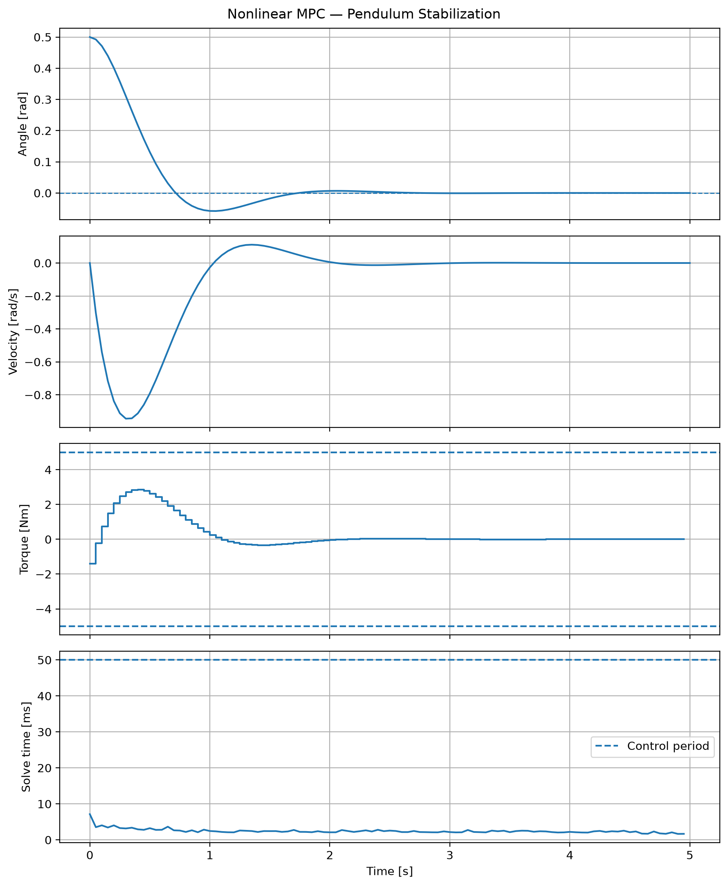
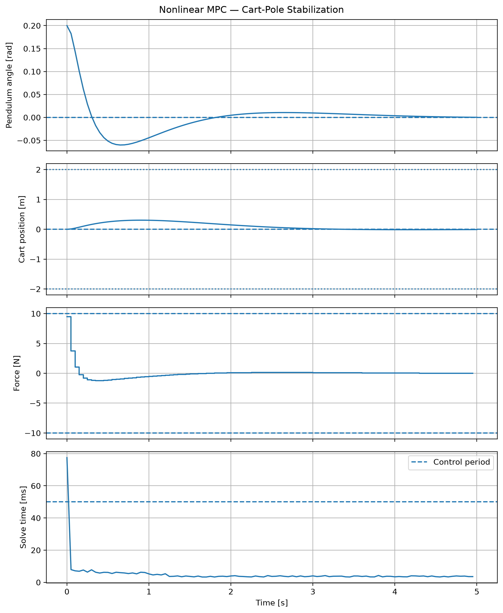
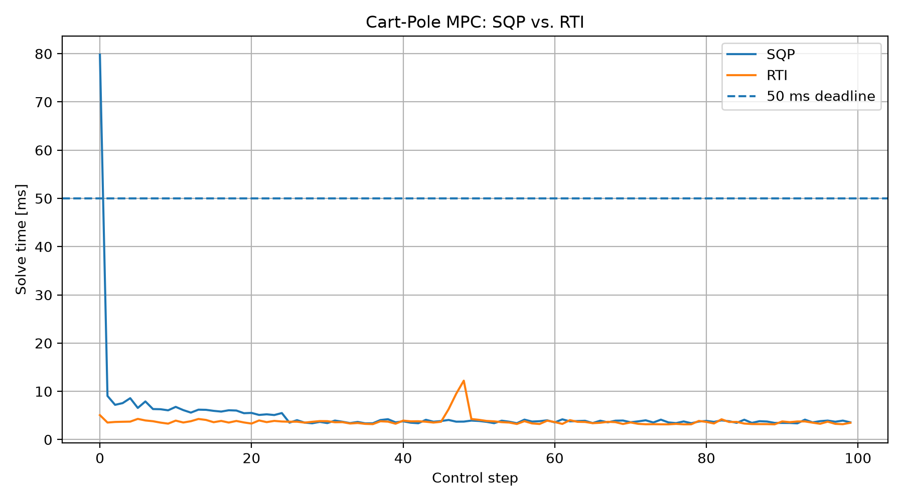
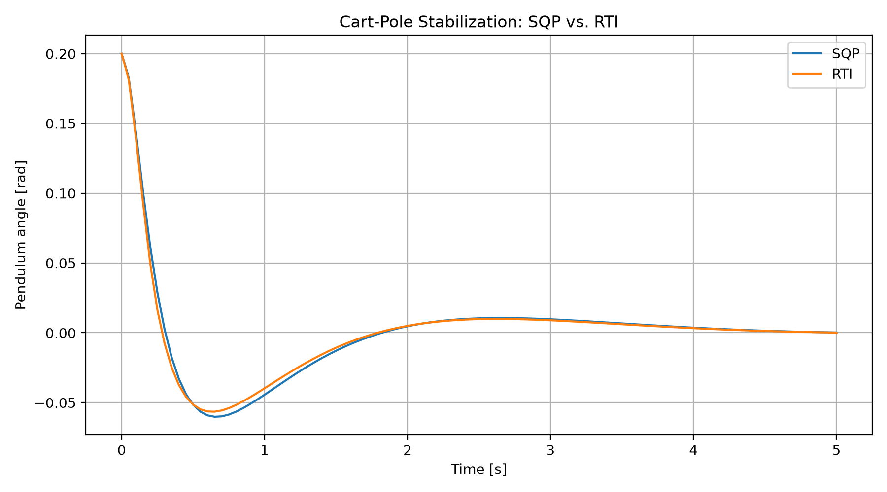

# GeneralMPC

**A modular nonlinear model predictive control (NMPC) framework in Python, using direct multiple shooting, Gauss–Newton sequential quadratic programming (SQP), CasADi and OSQP.**

GeneralMPC provides an inspectable implementation of a constrained nonlinear optimal-control solver. Users define continuous-time dynamics, weighted least-squares residuals and optional nonlinear constraints as CasADi functions; the framework constructs a discrete multiple-shooting nonlinear program (NLP) and solves successive sparse quadratic programs (QPs). It supports converged SQP and one-step real-time iteration (RTI), warm-started QP solves and optional application-specific C code generation for numerical kernels.

> **Scope:** A research and prototyping implementation, not a certified embedded or safety-critical controller. Generated C code accelerates numerical functions; the SQP loop and OSQP interface remain in Python.

## Highlights

- **Model interface:** continuous dynamics, stage and terminal least-squares residuals, optional path and terminal constraints, and time-varying online parameters.
- **Discretization:** fixed-step fourth-order Runge–Kutta (RK4) and direct multiple shooting.
- **Optimization:** Gauss–Newton SQP, sparse OSQP QPs, an ℓ₁-merit-function Armijo line search, and RTI mode.
- **Derivatives:** CasADi automatic differentiation for integration sensitivities and NLP linearization.
- **Receding horizon:** shifted-control warm starts with state rollout from the latest measured state.
- **Diagnostics:** objective, solver status, SQP/QP iteration counts, primal feasibility, stationarity, complementarity and solve times.
- **Code generation:** optional C kernels for dynamics, integration, derivatives, objective/constraints and QP data assembly.
- **Validation:** numerical unit tests, analytical reference cases, IPOPT cross-checks and nonlinear closed-loop simulations.

## Mathematical formulation

For continuous dynamics

$$
\dot{x}(t)=f(x(t),u(t),p(t)),
$$

GeneralMPC solves the finite-horizon least-squares problem

$$
\begin{aligned}
\min_{X,U}\quad &\frac12\sum_{k=0}^{N-1}\|h(x_k,u_k,p_k)\|_2^2
 +\frac12\|h_N(x_N,p_N)\|_2^2\\
\text{subject to}\quad &x_0=\hat{x}_0,\\
&x_{k+1}=\Phi_{\mathrm{RK4}}(x_k,u_k,p_k),\quad k=0,\ldots,N-1,\\
&\underline{x}\leq x_k\leq\overline{x},\quad
 \underline{u}\leq u_k\leq\overline{u},\\
&\underline{r}\leq r(x_k,u_k,p_k)\leq\overline{r},\\
&\underline{r}_N\leq r_N(x_N,p_N)\leq\overline{r}_N.
\end{aligned}
$$

The optional path-constraint rows are omitted if not defined. Control is held constant on each integration interval. Weights and reference offsets are incorporated in the user-supplied residual functions (for example, $h=\sqrt{Q}(x-x_{\mathrm{ref}})$).

Let $w$ contain all shooting states and controls, $r(w)$ the stacked least-squares residual, and $g(w)$ the NLP constraints. At SQP iteration $i$, the QP approximates

$$
\begin{aligned}
\min_d\quad &\tfrac12 d^\top H_i d +\nabla J(w_i)^\top d\\
\text{subject to}\quad &\underline g-g(w_i)\leq A_i d\leq\overline g-g(w_i),\\
&\underline w-w_i\leq d\leq\overline w-w_i,
\end{aligned}
$$

with $A_i=\nabla g(w_i)$ and the **regularized Gauss–Newton approximation**

$$
H_i=J_r(w_i)^\top J_r(w_i)+\lambda I.
$$

OSQP solves each sparse QP. In **SQP mode**, a merit-function line search selects the step size and iterations continue toward KKT convergence. In **RTI mode**, the controller takes one full QP step per solve. RTI does **not** guarantee that the resulting point satisfies the original nonlinear constraints.

The numerical design follows the SQP / direct-multiple-shooting formulation described in the **MATMPC paper** referenced below. This repository is an independent Python implementation inspired by those methods, **not the official MATMPC software or a feature-complete Python port**. In particular, this implementation does not provide MATMPC's condensing, CMoN-SQP or its full range of solver backends.

## Architecture

```text
User-defined CasADi model / bounds / options
                    │
                    ▼
            Transcription
        RK4 + multiple shooting
        AD + least-squares NLP
                    │
                    ▼
        Gauss–Newton SQP loop
          ┌─────────┴─────────┐
          ▼                   ▼
    Sparse QP assembly    Globalization
          │               (SQP line search
          ▼                or one RTI step)
       OSQP solver             │
          └─────────┬─────────┘
                    ▼
           Control + diagnostics
                    │
                    ▼
       Apply first control input

Optional: CasADi → generated C numerical kernels
          (Python controller loop is retained)
```

Key modules are under `src/generalmpc/`: `model.py`, `integrators.py`, `transcription.py`, `qp.py`, `globalization.py`, `controller.py`, `options.py` and `codegen.py`.

## Installation

**Requirements:** Python 3.10 or later; a C compiler is needed only for the optional code-generation workflow. Commands below assume a shell opened in the repository root.

### Option A — Python virtual environment (recommended)

macOS / Linux:

```bash
git clone https://github.com/Hadis26/GeneralMPC.git
cd GeneralMPC
python3 -m venv .venv
source .venv/bin/activate
python -m pip install --upgrade pip
python -m pip install -e ".[dev]"
```

Windows PowerShell:

```powershell
git clone https://github.com/Hadis26/GeneralMPC.git
cd GeneralMPC
py -m venv .venv
.venv\Scripts\Activate.ps1
python -m pip install --upgrade pip
python -m pip install -e ".[dev]"
```

If PowerShell prevents environment activation, use the environment's `python.exe` directly or follow your organization's execution-policy guidance.

### Option B — Conda environment

```bash
conda create -n generalmpc python=3.11 -y
conda activate generalmpc
python -m pip install --upgrade pip
python -m pip install -e ".[dev]"
```

Editable installation (`-e`) makes changes under `src/generalmpc/` available without reinstalling. The `[dev]` extra installs testing and plotting dependencies defined in `pyproject.toml`.

Verify the installation:

```bash
python -c "import generalmpc, casadi, osqp; print('Imports OK')"
python -m pytest tests/ -v
```

To leave the environment, run `deactivate` for `venv` or `conda deactivate` for Conda.

## Quick start

The following example controls a scalar integrator, $\dot{x}=u$, with a quadratic terminal penalty and limited control input:

```python
import casadi as ca
import numpy as np
from generalmpc import Model, Bounds, Options, Controller

x = ca.SX.sym("x", 1)
u = ca.SX.sym("u", 1)
p = ca.SX.sym("p", 0)

model = Model(
    nx=1,
    nu=1,
    np=0,
    rhs=ca.Function("rhs", [x, u, p], [u]),
    stage=ca.Function("stage", [x, u, p], [ca.sqrt(0.1) * u]),
    terminal=ca.Function("terminal", [x, p], [x]),
)

controller = Controller(
    model,
    Bounds(u_lower=[-2], u_upper=[2]),
    Options(N=1, dt=1.0, mode="sqp"),
)

result = controller.solve(measured=np.array([1.0]))
print(result.status, result.control)
# Expected solution: u ≈ -10/11 ≈ -0.90909
```

For longer horizons, call `solve(measured_state)` at each sampling instant, apply `result.control` (the first planned input), and repeat with the updated measurement. The result also provides the planned trajectories as `result.X` and `result.U`.

## Reproducible examples

From the repository root, with the environment activated:

```bash
python examples/pendulum_stabilization.py
python examples/cartpole_stabilization.py
```

| Example | Goal | Nominal setup |
|---|---|---|
| Nonlinear pendulum | Stabilize the downward equilibrium | Initial angle 0.5 rad, torque ±5 Nm |
| Cart-pole | Stabilize the **upright** equilibrium | Initial angle 0.2 rad, force ±10 N, cart position ±2 m |

The experiments generate figures and, where implemented, `.npz` numerical traces and `.json` metrics beneath `results/`.

### Pendulum stabilization



In one nominal 100-step simulation (5 s), the final angle was approximately **−1.0 × 10⁻⁵ rad**, with a final angular velocity of **−2.4 × 10⁻⁵ rad/s**. Maximum applied torque was **2.854 Nm**; mean SQP solve time was **2.677 ms**.

### Cart-pole stabilization



For the nominal 100-step cart-pole experiment, the final angle was approximately **2.15 × 10⁻⁴ rad** and the final cart position approximately **−8.83 × 10⁻³ m**. Maximum applied force was **9.487 N**, maximum cart displacement was **0.306 m**, and the maximum reported NLP constraint violation was **2.01 × 10⁻⁹** in SQP mode.

These are simulation outcomes for the specified models, not hardware experiments or general closed-loop stability guarantees.

## Verification and automated tests

```bash
python -m pytest tests/ -v
python -m pytest tests/ --cov=generalmpc --cov-report=term-missing
```

The recorded local test run (macOS, Python 3.11.13) reported:

| Metric | Result |
|---|---:|
| Tests | **45 passed** |
| Total statement coverage | **93%** |
| RK4 and C-code-generation module coverage | **100%** each |

Tests exercise dimension/bound validation, RK4/AD sensitivities, NLP transcription and derivatives, sparse QP solving, merit line search, controller behavior, and generated-kernel numerical equivalence. A nonlinear pendulum NLP was also cross-checked against **IPOPT**, yielding an absolute objective difference of **1.596 × 10⁻¹⁰** and a maximum control difference of **2.205 × 10⁻⁶**, with IPOPT initialized from the SQP solution. This is a **local solver consistency check**, not a proof of global optimality.

The GitHub Actions workflow under `.github/workflows/tests.yml` is intended to run the test suite on pushes and pull requests. The reference IPOPT plugin and C compiler must be available in the CI environment for their respective tests.

## Performance benchmarks

Run from the repository root:

```bash
python benchmarks/benchmark_sqp_vs_rti.py
python benchmarks/benchmark_codegen.py
```

### SQP versus RTI — cart-pole, one recorded run

| Metric | SQP | RTI |
|---|---:|---:|
| Mean solve time | 5.116 ms | 3.785 ms |
| Median solve time | 3.843 ms | 3.640 ms |
| 95th percentile | 7.221 ms | 4.276 ms |
| Maximum solve time | 79.817 ms | 12.212 ms |
| Steps within 50 ms | 99% | 100% |
| Final-state norm | 0.01204 | 0.01113 |
| Control effort $\Delta t\sum_k u_k^2$ | 6.100 | 6.817 |
| Maximum NLP constraint violation | **2.01 × 10⁻⁹** | **23.36** |





**Interpretation:** RTI used less compute time in this experiment but incurred large nonlinear shooting-constraint residuals during cold-start transient steps. The comparable final closed-loop states **must not** be interpreted as equivalent NLP feasibility, and the RTI data do not justify safety-critical deployment.

### CasADi versus generated C kernels — cart-pole, one recorded run

| Metric | Standard CasADi | Generated C |
|---|---:|---:|
| Mean solve time | 5.028 ms | 4.748 ms |
| Median solve time | 3.847 ms | 3.470 ms |
| 95th percentile | 7.392 ms | 7.528 ms |
| Maximum solve time | 78.037 ms | 72.108 ms |
| Mean SQP iterations | 1.44 | 1.44 |

The observed ratio of mean solve times was **1.059×** (roughly 5.6% lower mean time with generated kernels). The compared closed-loop state and control arrays were identical to the precision of the saved benchmark (`max_state_difference = 0`, `max_control_difference = 0`). C generation does **not** compile the full controller into a standalone binary.

**Benchmark caveat:** These are single-run measurements collected on a development Mac, not controlled multi-run performance studies. Cold-start behavior, Python overhead, machine load and platform can affect the measured timings. Neither worst-case execution time nor hard real-time capability is established.

## Optional C kernel generation

The `codegen.py` utilities export application-specific CasADi functions as C code, compile a shared library, and load its functions for numerical evaluation:

```python
from generalmpc.codegen import export_kernels, compile_kernels, load_kernels

source = export_kernels(controller, "results/benchmarks/generated")
library = compile_kernels(source)  # cc; macOS/Linux
load_kernels(controller, library)
```

The export is **model-specific** and should be regenerated if the model, horizon or symbolic transcription changes. Compilation with the provided helper targets macOS/Linux; Windows requires an appropriate compiler/build setup. Generated binaries are machine-specific build outputs and should generally not be committed to Git.

## Known limitations

- RTI performs a single full QP update, without nonlinear line-search globalization. Significant nonlinear dynamics residuals were observed during cold-start cart-pole tests.
- The current solver uses an explicit fixed-step RK4 integrator and a Gauss–Newton Hessian suitable for least-squares formulations; no exact-Hessian SQP or implicit DAE integrator is included.
- SQP is a **local** nonlinear optimization method. Convergence can depend on initialization, scaling, constraints and horizon selection.
- The numerical examples use matched nominal plant/controller models; robustness to noise, delay, actuator dynamics and model mismatch is not demonstrated.
- The Python-level loop and OSQP interface remain present when C numerical kernels are loaded.
- No hardware deployment, certified constraint enforcement, deterministic worst-case timing or general closed-loop stability proof is claimed.

## Project layout

```text
GeneralMPC/
├── src/generalmpc/          # NMPC solver implementation
├── tests/                   # Unit, integration and reference tests
├── examples/                # Reproducible closed-loop simulations
├── benchmarks/              # Runtime and backend comparisons
├── results/                 # Figures and selected experiment outputs
├── .github/workflows/       # Continuous integration
└── pyproject.toml           # Package and development dependencies
```

## References and acknowledgments

**Primary methodological reference**

Y. Chen, M. Bruschetta, E. Picotti, and A. Beghi, **“MATMPC — A MATLAB Based Toolbox for Real-time Nonlinear Model Predictive Control,”** *2019 18th European Control Conference (ECC)*, Naples, Italy, 2019. [Original MATMPC repository](https://github.com/chenyutao36/MATMPC).

The direct-multiple-shooting NLP, Gauss–Newton SQP/QP formulation, ℓ₁-merit globalization strategy and RTI scheme used here follow the numerical approach described in that paper. GeneralMPC is independently implemented in Python and does not include every algorithmic module of MATMPC.

**Software dependencies:** [CasADi](https://web.casadi.org/) provides symbolic expressions, automatic differentiation and code generation; [OSQP](https://osqp.org/) solves the sparse QP subproblems; [NumPy](https://numpy.org/) and [SciPy](https://scipy.org/) provide numerical/sparse-matrix support. [IPOPT](https://coin-or.github.io/Ipopt/) is used for the reference NLP validation.

## License

**All Rights Reserved.**

GeneralMPC is publicly available for source-code inspection and technical evaluation. No open-source license is granted.

Use, modification, redistribution, or incorporation into other software requires prior written permission from the copyright holder, except where otherwise permitted by law or applicable platform terms.

See [LICENSE](LICENSE) for details.
